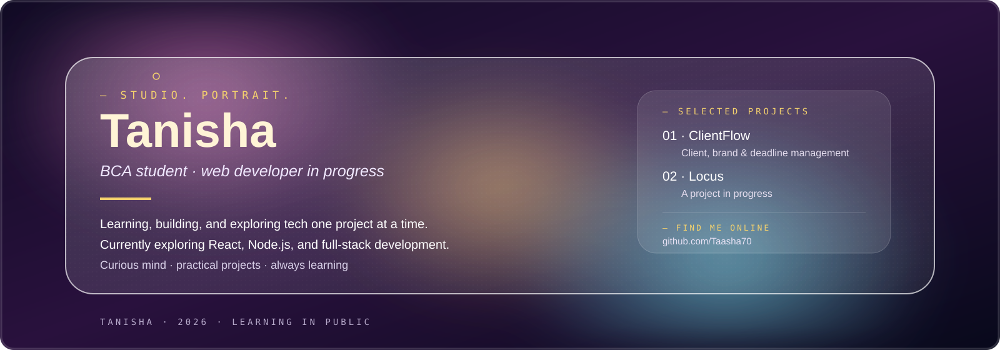

  

<h3 align="center">hey, i'm tanisha 👋</h3>

  BCA student • Aspiring developer • Forever curious 🌱

I'm a third-year BCA student from Delhi, exploring the world of tech one project at a time. I enjoy building things, experimenting with new technologies, and learning how ideas turn into real products. This is where I share what I'm working on and what I'm learning along the way.

---

### 🛠️ things i work with

  
  
  
  
  
  
  
  
  

### 🚀 things i've been building

- **ClientFlow** — A client, brand, and deadline management system.
- **Locus** — A project I'm currently exploring and building.
- **More experiments** — [Browse my repositories →](https://github.com/Taasha70?tab=repositories)

### 🌱 currently

Learning full-stack development, improving my problem-solving skills, exploring open source, and building projects that help me grow as a developer.

### ☕ beyond the code

I enjoy reading, organizing ideas, exploring random topics, and collaborating with people who love learning and building things.

### 🤝 let's connect

  
  

  <i>still learning, still building, always curious ✨</i>

